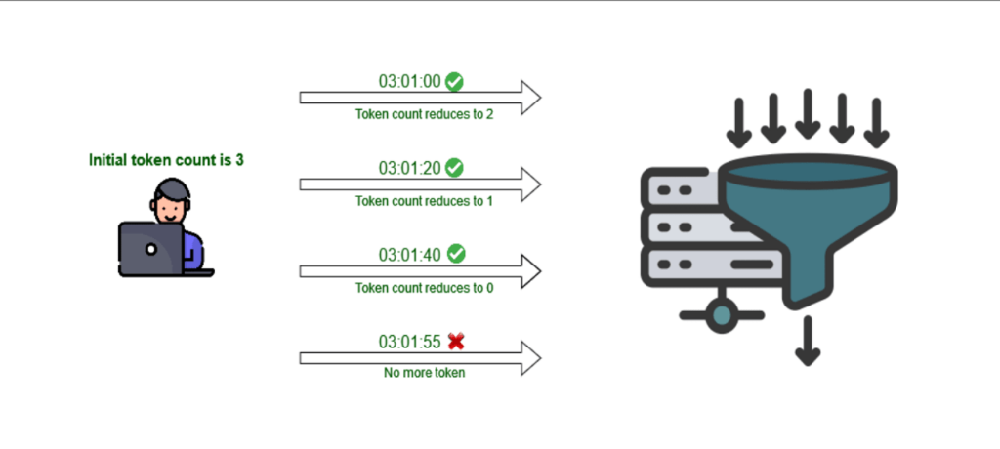

# 🎮🛡️ Campuslands - Ejercicio Interactivo de `express-rate-limit` y Middlewares (API de Videojuegos en Memoria)

> **Guía pedagógica y laboratorio práctico oficial** para campers y entrenadores de **Campuslands**. Aprende a proteger tus servidores **Node.js** y **Express** frente a ataques de denegación de servicio (**DoS**) y abuso de tráfico implementando **`express-rate-limit`** como middleware sobre un **CRUD completo de Videojuegos almacenados en un arreglo en memoria** (sin bases de datos externas) utilizando **ECMAScript Modules (ESM)**.

[](https://nodejs.org/)
[](https://expressjs.com/)
[](https://www.npmjs.com/package/express-rate-limit)
[-blue.svg)](https://nodejs.org/api/esm.html)
[](src/data/videojuegos.db.js)
[](https://anndreloopez012.github.io/campuslands-express-ratelimit-interactivo/)
[](https://campuslands.com)

---

## 🌐 🖥️ Plataforma Web Interactiva en Vivo (GitHub Pages)

> 💡 **¿Quieres estudiar la teoría paso a paso, ver el código estilo VS Code y probar el bloqueo `429 Too Many Requests` sin instalar nada?**  
> Hemos publicado una **landing interactiva completa** accesible desde cualquier navegador.

👉 **Abre la plataforma interactiva aquí:**  
### 🔗 **[https://anndreloopez012.github.io/campuslands-express-ratelimit-interactivo/](https://anndreloopez012.github.io/campuslands-express-ratelimit-interactivo/)**

### 🎯 ¿Qué incluye la página web interactiva?
1. **Diagrama Vectorial Interactivo de Tokens y Embudo (Slide 2):** Simulación paso a paso del reloj (`03:01:00` → `03:01:20` → `03:01:40` → `03:01:55`) mostrando cómo se descuentan los 3 tokens iniciales hasta disparar `No more token` (`429 Too Many Requests`).
2. **Buscador en Vivo de las 14 Opciones Oficiales (Slide 4):** Tabla interactiva con todas las propiedades de `express-rate-limit`, tipos de datos y enlaces directos a la documentación oficial en Mintlify.
3. **Progresión de Código en Ventanas VS Code Dark+ (Slides 5, 6 y 7):** Ejemplos de las secciones **2, 2.1, 2.2, 2.3 y 3** adaptados al catálogo de Videojuegos, con resaltado sintáctico de VS Code y ajuste automático de línea (`word-wrap`) para que nunca se corte ni se oculte ninguna línea.
4. **Explorador Interactivo Línea por Línea (Slide 9):** Haz clic en cualquier línea de `src/app.js`, `src/middlewares/rateLimiter.js`, `src/routes/videojuegos.routes.js` o `src/data/videojuegos.db.js` para leer su análisis técnico detallado.
5. **Simulador en Vivo con HUD de Tokens y Bloqueo 429 (Slide 11):** Cliente HTTP integrado en el navegador con contador visual de tokens, cronómetro de ventana `windowMs`, botón de **Ráfaga DoS** y tabla reactiva del arreglo de videojuegos en memoria.

---

## 🛡️ 1. Introducción a `express-rate-limit`


*Tomado de: [Toptal - Secure REST API in Node.js](https://bs-uploads.toptal.io/blackfish-uploads/components/seo/content/og_image_file/og_image/1302192/secure-rest-api-in-nodejs-18f43b3033c239da5d2525cfd9fdc98f.png)*

**`express-rate-limit`** es un middleware de **Express** (el popular framework de Node.js para construir aplicaciones web y APIs REST). Se utiliza para **limitar la tasa de solicitudes** que pueden hacerse a una aplicación o ruta de Express, ayudando a prevenir ataques de **denegación de servicio (DoS)**, fuerza bruta y scraping masivo al restringir el número de peticiones que un cliente puede realizar en un período de tiempo determinado.

Cuando usas `express-rate-limit`, puedes configurar el límite de solicitudes permitidas dentro de una ventana de tiempo (por ejemplo, **100 solicitudes por hora** o **5 solicitudes por minuto** por dirección IP). Si un cliente supera este límite, el middleware responde automáticamente con el código de estado HTTP **`429 Too Many Requests` (Demasiadas solicitudes)**, indicando al cliente que debe esperar antes de realizar más peticiones.

📦 **Página oficial del paquete en NPM:**  
🔗 [https://www.npmjs.com/package/express-rate-limit](https://www.npmjs.com/package/express-rate-limit)

### ⏱️ ¿Cómo funciona el descuento de Tokens por Ventana de Tiempo?



Si configuramos un límite inicial de **3 solicitudes por minuto** (`max: 3`, `windowMs: 60 * 1000`):
- **Inicio (`Initial token count is 3`)**: La dirección IP del jugador arranca con **3 tokens disponibles**.
- **`03:01:00` ✅ (Petición #1)**: El servidor procesa la solicitud (`200 OK`) y **el contador de tokens se reduce a 2**.
- **`03:01:20` ✅ (Petición #2)**: El servidor procesa la solicitud (`200 OK`) y **el contador de tokens se reduce a 1**.
- **`03:01:40` ✅ (Petición #3)**: El servidor procesa la solicitud (`200 OK`) y **el contador de tokens se reduce a 0**.
- **`03:01:55` ❌ (Petición #4)**: Como sigue dentro del mismo minuto y **no quedan más tokens (`No more token`)**, el embudo del middleware bloquea la petición y devuelve **`429 Too Many Requests`**.

---

## ✨ 1.1. Características Principales y las 14 Opciones de Configuración

### Las 8 Características Clave
1. **Limitación de tasa de solicitudes:** Permite configurar un tope exacto de solicitudes a una ruta o a toda la aplicación Express en un período de tiempo.
2. **Prevención de ataques DoS:** Protege la aplicación contra ataques de denegación de servicio limitando las peticiones provenientes de una IP específica.
3. **Configuración flexible:** Permite definir la ventana de tiempo (`windowMs`) y el máximo de solicitudes (`limit` / `max`) por minuto, hora o día.
4. **Respuestas personalizadas:** Permite enviar textos o estructuras JSON personalizadas (`message`) cuando el cliente supera el límite.
5. **Integración fácil con Express:** Se incorpora limpiamente en la cadena de middlewares con `app.use()`.
6. **Restricciones por dirección IP:** Identifica automáticamente la IP del cliente (`req.ip`) para frenar spam o abusos.
7. **Opciones avanzadas:** Incluye `skip`, `handler`, `standardHeaders`, `legacyHeaders`, `keyGenerator`, `store`, entre otras.
8. **Monitoreo de solicitudes:** Expone métricas y cabeceras HTTP útiles para auditar el consumo de la API.

### Tabla Oficial de las 14 Opciones de Configuración

| Opción | Tipo | Descripción |
| :--- | :--- | :--- |
| [**`windowMs`**](https://express-rate-limit.mintlify.app/reference/configuration#windowms) | `number` | Especifica cuánto tiempo recordar las solicitudes, en **milisegundos**. Durante este período, las solicitudes se rastrean para verificar si exceden el límite establecido. |
| [**`limit`**](https://express-rate-limit.mintlify.app/reference/configuration#limit) *(o `max`)* | `number \| function` | Es el límite de solicitudes permitidas dentro de la ventana especificada. Puede ser un número fijo o una función que devuelve un número dinámico basado en la solicitud. |
| [**`message`**](https://express-rate-limit.mintlify.app/reference/configuration#message) | `string \| json \| function` | Es la respuesta que se enviará después de que se alcance el límite de solicitudes. Puede ser un mensaje de texto, un objeto JSON o una función que genera la respuesta. |
| [**`statusCode`**](https://express-rate-limit.mintlify.app/reference/configuration#statuscode) | `number` | Es el código de estado HTTP que se enviará después de que se alcance el límite. El valor predeterminado es **`429`** (*Demasiadas solicitudes*). |
| [**`legacyHeaders`**](https://express-rate-limit.mintlify.app/reference/configuration#legacyheaders) | `boolean` | Cuando está habilitado (`true`), agrega los encabezados `X-RateLimit-Limit`, `X-RateLimit-Remaining` y `X-RateLimit-Reset` a la respuesta. |
| [**`standardHeaders`**](https://express-rate-limit.mintlify.app/reference/configuration#standardheaders) | `'draft-6' \| 'draft-7'` | Habilita el encabezado estándar `RateLimit` en la respuesta. Puede ser `'draft-6'` o `'draft-7'`. |
| [**`requestPropertyName`**](https://express-rate-limit.mintlify.app/reference/configuration#requestpropertyname) | `string` | Agrega información sobre el límite de tasa a la solicitud (`req.rateLimit`) del objeto Express. Puedes personalizar el nombre de la propiedad que se agrega. |
| [**`skipFailedRequests`**](https://express-rate-limit.mintlify.app/reference/configuration#skipfailedrequests) | `boolean` | Si está habilitado, las respuestas de estado `4xx`/`5xx` no se contarán para el límite de tasa. |
| [**`keyGenerator`**](https://express-rate-limit.mintlify.app/reference/configuration#keygenerator) | `function` | Es una función que identifica a los usuarios. Por defecto, utiliza la dirección IP del cliente (`req.ip`), pero puedes personalizarla para identificar a los usuarios de manera diferente. |
| [**`handler`**](https://express-rate-limit.mintlify.app/reference/configuration#handler) | `function` | Una función que se ejecuta después de que se alcance el límite. Puede anular los valores de `message` y `statusCode` si está configurado. |
| [**`skip`**](https://express-rate-limit.mintlify.app/reference/configuration#skip) | `function` | Una función que puede devolver `true` para omitir el limitador para una solicitud específica. |
| [**`requestWasSuccessful`**](https://express-rate-limit.mintlify.app/reference/configuration#requestwassuccessful) | `function` | Se utiliza en conjunto con `skipFailedRequests` y `skipSuccessfulRequests` para determinar si una solicitud fue exitosa o no. |
| [**`validate`**](https://express-rate-limit.mintlify.app/reference/configuration#validate) | `boolean \| object` | Habilita o deshabilita las verificaciones de validación integradas. Puede ser un booleano o un objeto de opciones. |
| [**`store`**](https://express-rate-limit.mintlify.app/reference/configuration#store) | `Store` | Permite usar un almacenamiento personalizado (Memoria, Redis, Memcached, MongoDB) para compartir recuentos de solicitudes entre múltiples nodos de aplicación. |

---

## 🛠️ 2. Progresión Paso a Paso: De Configuración Básica a Middleware Modular

### 2. Instalación y Configuración Básica (5 solicitudes por minuto)
```bash
mkdir express-rate-limit-videojuegos
cd express-rate-limit-videojuegos
npm init -y
npm install express express-rate-limit
```

```javascript
import express from 'express';
import { rateLimit } from 'express-rate-limit';

const app = express();

// Define un limitador de tasa con un máximo de 5 solicitudes por minuto
const limiter = rateLimit({
  windowMs: 60 * 1000, // 1 minuto
  max: 5, // 5 solicitudes por ventana
  message: 'Demasiadas solicitudes a la tienda de videojuegos desde esta IP, por favor intenta de nuevo en un minuto.',
});

// Aplica el limitador de tasa a todas las solicitudes
app.use(limiter);

// Ruta de ejemplo de videojuegos
app.get('/', (req, res) => {
  res.send('¡Bienvenido al Catálogo Gamer de Campuslands!');
});

// Inicia el servidor en el puerto 3000
const PORT = 3000;
app.listen(PORT, () => {
  console.log(`Servidor de videojuegos iniciado en http://localhost:${PORT}`);
});
```

### 2.1. Respuestas y Códigos de Estado (`statusCode: 429`)
```javascript
import express from 'express';
import { rateLimit } from 'express-rate-limit';

const app = express();

// Definir un limitador de tasa con código de estado 429 explícito
const limiter = rateLimit({
  windowMs: 60 * 1000, // 1 minuto (60 segundos * 1000 milisegundos)
  max: 3, // 3 solicitudes por minuto
  message: 'Demasiadas solicitudes desde esta IP, por favor intenta de nuevo en un minuto.',
  statusCode: 429 // Código de estado HTTP 429
});

// Aplicar el limitador a todas las solicitudes
app.use(limiter);

app.get('/', (req, res) => {
  res.send('¡Bienvenido al Servidor de Videojuegos!');
});

const PORT = 3000;
app.listen(PORT, () => {
  console.log(`Servidor iniciado en http://localhost:${PORT}`);
});
```

### 2.2. Mensajes y Encabezados HTTP (`headers` / `legacyHeaders` / `standardHeaders`)
```javascript
import express from 'express';
import { rateLimit } from 'express-rate-limit';

const app = express();

// Definir un limitador de tasa habilitando encabezados en la respuesta
const limiter = rateLimit({
  windowMs: 60 * 1000, // 1 minuto
  max: 2, // 2 solicitudes por minuto
  message: 'Demasiadas solicitudes desde esta IP, por favor intenta de nuevo en un minuto.',
  legacyHeaders: true, // Habilita encabezados X-RateLimit-*
  standardHeaders: 'draft-7', // Habilita encabezado estándar RateLimit
});

app.use(limiter);

app.get('/', (req, res) => {
  res.send('¡Consulta de videojuegos con encabezados RateLimit activos!');
});

const PORT = 3000;
app.listen(PORT, () => {
  console.log(`Servidor iniciado en http://localhost:${PORT}`);
});
```

### 2.3. Seguridad y Protección de la API (`app.use('/api/', apiLimiter)`)
```javascript
import express from 'express';
import { rateLimit } from 'express-rate-limit';

const app = express();

// Definir un limitador de tasa para protección de la API de videojuegos
const apiLimiter = rateLimit({
  windowMs: 60 * 1000, // 1 minuto
  max: 5, // 5 solicitudes por minuto
  message: 'Demasiadas solicitudes a la API de videojuegos desde esta IP, intenta de nuevo en un minuto.',
});

// Aplicar el limitador únicamente a las rutas que comiencen con '/api/'
app.use('/api/', apiLimiter);

// Ruta de ejemplo para la API de videojuegos
app.get('/api/videojuegos', (req, res) => {
  res.json({
    message: 'Catálogo de videojuegos de la API obtenido exitosamente.'
  });
});

const PORT = 3000;
app.listen(PORT, () => {
  console.log(`Servidor iniciado en http://localhost:${PORT}`);
});
```

### 3. Configuración del `rateLimit` como un Middleware Modular (`helperLimit.js`)

**Archivo 1: `src/helperLimit.js` (o `src/middlewares/rateLimiter.js`)**
```javascript
import { rateLimit } from 'express-rate-limit';

// Definir y exportar el limitador de tasa para protección de la API
export const apiLimiter = rateLimit({
  windowMs: 60 * 1000, // 1 minuto
  max: 5, // 5 solicitudes por minuto
  message: 'Demasiadas solicitudes desde esta IP, por favor intenta de nuevo en un minuto.',
});
```

**Archivo 2: `src/app.js`**
```javascript
import express from 'express';
import { apiLimiter } from './helperLimit.js';

const app = express();

// Aplicar el limitador de tasa a todas las solicitudes que comiencen con '/api/'
app.use('/api/', apiLimiter);

// Ruta para consultar videojuegos de la API
app.get('/api/videojuegos', (req, res) => {
  res.json({
    message: 'Datos del catálogo de videojuegos obtenidos exitosamente.'
  });
});

const PORT = 3000;
app.listen(PORT, () => {
  console.log(`Servidor iniciado en http://localhost:${PORT}`);
});
```

---

## 🏗️ Estructura del Ejercicio Completo en Este Repositorio

```text
campuslands-express-ratelimit-interactivo/
├── assets/
│   └── rate-limit-token-flow.png    # Diagrama de conteo de tokens y embudo HTTP
├── src/
│   ├── data/
│   │   └── videojuegos.db.js        # Base de datos en memoria (Arreglo de Videojuegos)
│   ├── middlewares/
│   │   ├── rateLimiter.js           # Configuración de apiLimiter (5 req/min) y crearJuegoLimiter (3 req/min)
│   │   ├── logger.js                # Registro de tráfico HTTP en consola
│   │   ├── validator.js             # Validación de titulo, genero, plataforma y precio
│   │   └── errorHandler.js          # Captura global de errores (4 parámetros)
│   ├── routes/
│   │   └── videojuegos.routes.js    # Enrutador CRUD completo (/api/videojuegos)
│   ├── helperLimit.js               # Re-exportación compatible con la Sección 3 de la guía
│   └── app.js                       # Servidor Express, montaje de apiLimiter y rutas
├── test/
│   └── test-api.js                  # Pruebas automatizadas E2E (CRUD + Bloqueo 429 en la 6ta petición)
├── index.html                       # Plataforma web interactiva (VS Code Dark+ + Simulador 429)
├── package.json                     # Configuración ESM ("type": "module") y scripts
└── README.md                        # Documentación pedagógica integral
```

---

## 📋 Endpoints del CRUD de Videojuegos (`/api/videojuegos`)

| Método | Endpoint | Protección Rate Limit | Descripción | Códigos HTTP |
| :--- | :--- | :--- | :--- | :--- |
| `GET` | `/` | Libre (Ruta pública) | Bienvenida y estado del servidor | `200` |
| `GET` | `/api/videojuegos` | `apiLimiter` (5 req/min) | Lista todos los videojuegos del arreglo en memoria | `200`, `429` |
| `GET` | `/api/videojuegos/:id` | `apiLimiter` (5 req/min) | Busca un videojuego por su ID numérico | `200`, `400`, `404`, `429` |
| `POST` | `/api/videojuegos` | `apiLimiter` + `crearJuegoLimiter` | Agrega un nuevo videojuego al arreglo | `201`, `400`, `429` |
| `PUT` | `/api/videojuegos/:id` | `apiLimiter` (5 req/min) | Actualiza un videojuego existente por su ID | `200`, `400`, `404`, `429` |
| `DELETE` | `/api/videojuegos/:id` | `apiLimiter` (5 req/min) | Elimina un videojuego del arreglo por su ID | `200`, `400`, `404`, `429` |

---

## 💻 Instalación y Ejecución Local

### 1. Clonar el Repositorio e Instalar Dependencias
```bash
git clone https://github.com/anndreloopez012/campuslands-express-ratelimit-interactivo.git
cd campuslands-express-ratelimit-interactivo
npm install
```

### 2. Iniciar el Servidor
```bash
# Modo desarrollo con reinicio automático:
npm run dev

# Modo estándar:
npm start
```

### 3. Ejecutar las Pruebas Automatizadas (Verifica CRUD + Error 429)
```bash
npm test
```

### 4. Disparar el Bloqueo `429 Too Many Requests` desde tu Terminal
```bash
for i in {1..6}; do
  echo "\n--- Petición #$i ---"
  curl -i http://localhost:3000/api/videojuegos
done
```

---

## 🌿 Flujo de Trabajo por Ramas (Git Flow)

El proyecto fue desarrollado e integrado siguiendo un flujo limpio por ramas:
- **`main`**: Rama de producción estable y origen del despliegue en GitHub Pages.
- **`dev`**: Rama de integración donde se unifican y prueban las funcionalidades.
- **Ramas de características (`feat/*`)**:
  - `feat/01-setup-esm-ratelimit`: Configuración de `package.json` en modo ESM con `express` y `express-rate-limit`.
  - `feat/02-data-videojuegos-array`: Arreglo en memoria de videojuegos (`src/data/videojuegos.db.js`).
  - `feat/03-middlewares-ratelimit-helper`: Implementación de `rateLimiter.js`, `helperLimit.js`, `logger.js`, `validator.js` y `errorHandler.js`.
  - `feat/04-routes-crud-videojuegos-and-tests`: Enrutador CRUD (`videojuegos.routes.js`), `app.js` y suite de pruebas `test-api.js`.
  - `feat/05-interactive-web-vscode-explainer`: Plataforma web interactiva `index.html` con visor VS Code Dark+ y simulador en vivo.
  - `feat/06-documentation-readme`: Documentación pedagógica paso a paso en `README.md`.

---

## 📄 Licencia

Distribuido bajo la Licencia **MIT**. Consulta el archivo [LICENSE](LICENSE) para más información. Desarrollado con fines educativos para **Campuslands**.
